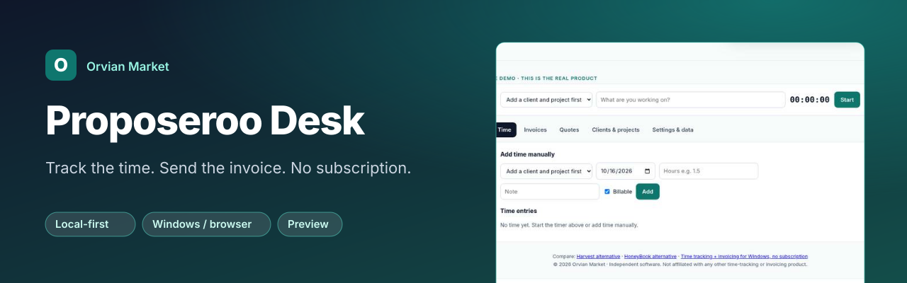
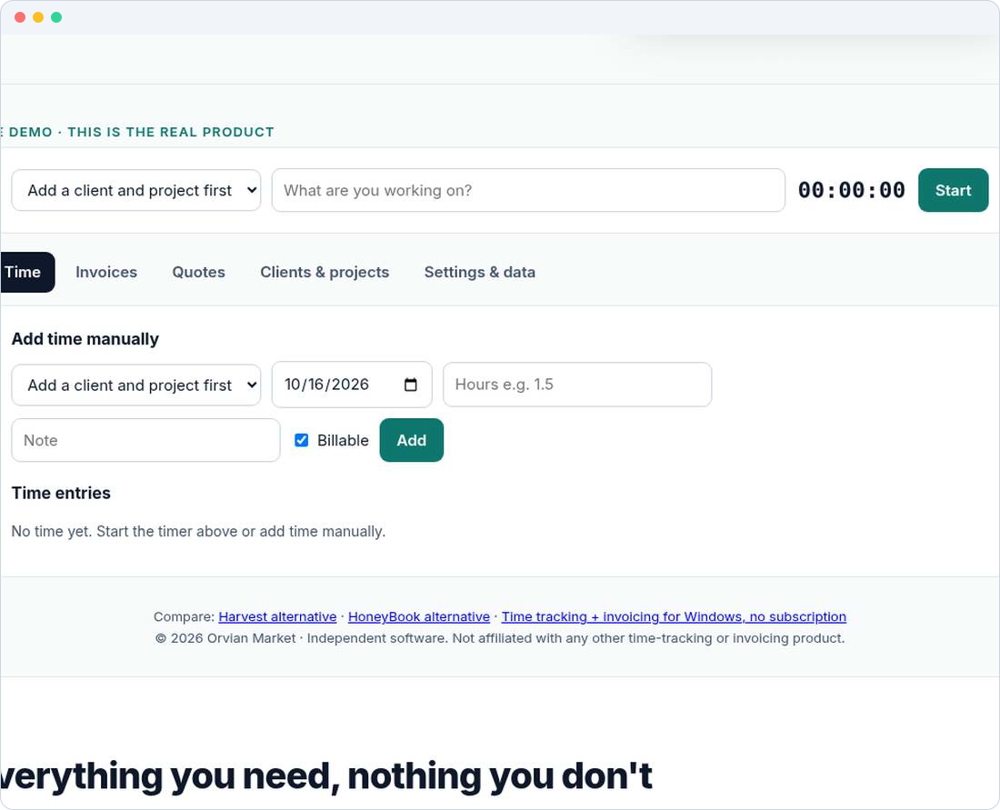

<b><a href="https://jhodges3401-code.github.io/rate-calculator/desk/">Open the live app</a></b> · ⭐ <b>Star this repo</b> to follow the 1.0 release

# Proposeroo Desk (preview)
Local-first quotes, time tracking and invoices that run entirely in your browser. No account, no server, and no network calls. Built from scratch by Orvian Market.

## Features
| | |
|---|---|
| ⏱️ Timer and manual time entries | 🧾 Invoices and quotes, print-optimized for "Save as PDF" |
| 👥 Clients and projects | 💾 One JSON document in `localStorage` (`prd:v1`) |
| 📤 JSON backup and CSV export | 🔒 No account, no network calls |

## Quick start
Open the [live app](https://jhodges3401-code.github.io/rate-calculator/desk/), or clone this repo and serve the folder with any static server (`npx serve .`).

## Development
- Spec: [SPEC.md](SPEC.md)
- Tests: `node --test test/core.test.mjs` (core) and `node test/e2e.mjs <url> <shotDir>` (browser)

Preview build. Not yet for sale. Independent software; not affiliated with any vendor named in the comparison pages.
